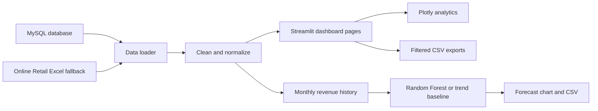

# SalesIQ

### AI-powered sales intelligence, analytics & forecasting (https://anindasau-salesiq-ai-powered-sales-prediction-dashbo-app-rw8aai.streamlit.app/)

SalesIQ is a multi-page sales dashboard built with Python and Streamlit. It turns sales transactions into interactive business views: track revenue, compare products and markets, explore historical trends, and generate monthly revenue forecasts. It ships with a dark dashboard theme, MySQL support, and a bundled Excel dataset so you can get started without first configuring a database.

> **Current demo data:** the bundled Online Retail workbook has been imported into the configured MySQL database. The observed dataset spans December 2010–December 2011. Use your own compatible sales data for current business reporting; forecasts reflect the history supplied to the app.

---

## Contents

- [Highlights](#highlights)
- [Dashboard pages](#dashboard-pages)
- [Technology](#technology)
- [How it works](#how-it-works)
- [Project layout](#project-layout)
- [Requirements](#requirements)
- [Run the app on Windows](#run-the-app-on-windows)
- [Configure MySQL](#configure-mysql)
- [Import sales data](#import-sales-data)
- [Use a different dataset](#use-a-different-dataset)
- [Forecasting and model training](#forecasting-and-model-training)
- [Run the tests](#run-the-tests)
- [Troubleshooting](#troubleshooting)
- [Data, security and limitations](#data-security-and-limitations)

## Highlights

- **Dark-first interface** with a consistent visual style, responsive layout, KPI cards, and interactive charts.
- **Interactive analysis** with date, product, and market filtering.
- **Sales metrics** including revenue, unique invoices, units sold, and average order value.
- **Period comparison** showing revenue change versus the preceding date range when a comparison period exists.
- **Monthly revenue forecasting** for selectable horizons of 3, 6, 9, or 12 months.
- **MySQL-first data loading** with an automatic Excel fallback when the database cannot be read.
- **CSV exports** for filtered sales, forecast results, and product reports.
- **Repeat-safe importer** that cleans source rows, inserts in batches, and avoids importing the same workbook rows twice.
- **Automated tests** for cleaning, analytics, month continuity, and forecast behavior.

## Dashboard pages

| Page | What it shows |
| --- | --- |
| **Sales at a glance** | Overview KPIs, comparison to the previous period, monthly revenue, top products, revenue by country, transaction detail, and a filtered sales export. Filters are in the sidebar. |
| **Sales analytics** | Revenue and units by month, average transaction value by month, and a product leaderboard. Select an analysis date range. |
| **Sales forecasting** | Historical revenue beside a 3–12 month forecast, next-month projection, projected horizon revenue, holdout MAE when available, and a downloadable forecast table. |
| **Product performance** | Product selector, revenue leaderboard, revenue-versus-units scatter plot, full product table, and downloadable product report. |

### Metric definitions

- **Revenue** = sum of `Quantity × UnitPrice` for included sale rows.
- **Orders** = count of distinct invoice numbers.
- **Units sold** = sum of quantities.
- **Average order value** = revenue divided by distinct invoice count.
- **Holdout MAE** = average absolute difference between actual revenue and predictions for later historical months excluded from a small evaluation fit. A lower MAE is better, but it is not a guarantee of future accuracy.

Cancelled invoices and invalid, zero-quantity, or non-positive-price rows are excluded by the shared cleaning step.

## Technology

- **Python** — application and data-pipeline language
- **Streamlit** — interactive multi-page web application
- **Pandas** — data cleaning, grouping, and feature preparation
- **Plotly** — interactive charts
- **scikit-learn** — Random Forest regression and evaluation metrics
- **MySQL + SQLAlchemy + PyMySQL** — persistent relational sales data
- **openpyxl** — reading the Excel workbook
- **pytest** — automated tests

## How it works



The shared loader in [src/data_loader.py](src/data_loader.py) tries MySQL first. If the query fails or the database has no rows, it attempts to read the bundled workbook at [data/raw/Online%20Retail.xlsx](data/raw/Online%20Retail.xlsx). Both sources are normalized and cleaned with [src/preprocessing.py](src/preprocessing.py). Loaded records are cached for five minutes by Streamlit; use the **Refresh data** button on the overview page to clear the cache.

The shared dashboard styles and currency formatting are in [src/dashboard.py](src/dashboard.py). Reusable KPIs and monthly/product grouping are in [src/analytics.py](src/analytics.py). The individual Streamlit pages are in [app.py](app.py) and [pages](pages).

## Project layout

```text
SalesIQ/
├── app.py                         # Sales at a glance / dashboard home
├── pages/
│   ├── 1_Sales_Analytics.py       # Historical analytics
│   ├── 2_Sales_Forecasting.py     # Revenue forecast
│   └── 3_Product_Performance.py   # Product rankings and comparison
├── src/
│   ├── analytics.py               # KPI and sales aggregations
│   ├── dashboard.py               # Shared styles and formatting
│   ├── data_loader.py             # MySQL loader and Excel fallback
│   ├── db.py                      # SQLAlchemy MySQL connection
│   ├── features.py                # Monthly forecasting features
│   ├── predict.py                 # Dashboard forecast routine
│   ├── preprocessing.py           # Shared transaction cleaning
│   ├── create_monthly_sales.py    # Excel-to-monthly-CSV utility
│   └── train_model.py             # Separate model training utility
├── database/
│   ├── schema.sql                 # MySQL database and table definitions
│   └── seed_data.py               # Repeat-safe Excel-to-MySQL importer
├── data/
│   ├── raw/                       # Source workbook
│   └── processed/                 # Monthly revenue CSV for model training
├── models/                        # Generated model artifact (optional)
├── reports/                       # Generated training metrics (optional)
├── tests/                         # pytest suite
├── .env.example                   # MySQL configuration template
├── .gitignore                     # Ignores local secrets and artifacts
├── README.md
└── requirements.txt               # Pinned Python packages
```

## Requirements

- Windows 10/11, macOS, or Linux
- Python 3.10 or newer (a compatible Python environment is recommended)
- MySQL Server and MySQL Workbench **only if you want to use the database**
- Git is optional

The project already includes a Windows environment at `salesiqvenv`. The commands below use it. From the project root, open a PowerShell terminal in VS Code.

## Run the app on Windows

### Fastest: use the existing environment

```powershell
cd D:\SalesIQ
.\salesiqvenv\Scripts\Activate.ps1
python -m streamlit run app.py
```

Open the **Local URL** printed by Streamlit, normally [http://localhost:8501](http://localhost:8501). Keep the terminal open while the app is running. Press **Ctrl+C** in that terminal to stop it.

If PowerShell prevents environment activation, call its Python executable directly:

```powershell
cd D:\SalesIQ
.\salesiqvenv\Scripts\python.exe -m streamlit run app.py
```

### Set up a fresh environment

Run these from the project root. If your Python launcher is not `py`, use the installed Python executable instead.

```powershell
cd D:\SalesIQ
py -m venv .venv
.\.venv\Scripts\Activate.ps1
python -m pip install --upgrade pip
python -m pip install -r requirements.txt
python -m streamlit run app.py
```

If PowerShell blocks activation, use `.\.venv\Scripts\python.exe -m pip install -r requirements.txt` and `.\.venv\Scripts\python.exe -m streamlit run app.py` instead.

## Configure MySQL

The app reads these environment variables through [src/db.py](src/db.py):

| Variable | Purpose | Default |
| --- | --- | --- |
| `DB_HOST` | MySQL server address | `localhost` |
| `DB_PORT` | MySQL port | `3306` |
| `DB_NAME` | Database name | `sales_dashboard` |
| `DB_USER` | MySQL username | No default; set it locally |
| `DB_PASSWORD` | MySQL password | No default; set it locally |

1. In the project root, copy [`.env.example`](.env.example) to a local `.env` file.
2. Set `DB_HOST`, `DB_PORT`, `DB_NAME`, `DB_USER`, and `DB_PASSWORD` to match your MySQL installation.
3. In MySQL Workbench, connect to your server and open/run [database/schema.sql](database/schema.sql). It creates the `sales_dashboard` database and the `products` and `sales` tables if they do not already exist.
4. Keep MySQL Server running, then import the workbook as described below.

The MySQL user needs permission to connect to the configured database and read/write the tables. To run the schema itself, the Workbench account also needs permission to create a database and tables. The importer can add its `source_key` column to an older `sales` table to make future imports repeat-safe; it preserves existing records.

**Never commit the local `.env` file or put database passwords in source code.** The project `.gitignore` excludes `.env`. The template uses example placeholders only; replace them with your own local values.

## Import sales data

After MySQL is running, `.env` is configured, and the schema exists, import the bundled workbook:

```powershell
cd D:\SalesIQ
.\salesiqvenv\Scripts\python.exe -m database.seed_data
```

The importer reads the default workbook from [data/raw/Online%20Retail.xlsx](data/raw/Online%20Retail.xlsx), removes invalid/cancelled/non-sale rows, updates product names, then inserts sales in batches. Existing source rows are skipped on later runs. Successful output reports product counts and newly imported transactions.

To import another Excel workbook, pass its path as the final argument:

```powershell
.\salesiqvenv\Scripts\python.exe -m database.seed_data "D:\path\to\your\sales.xlsx"
```

The workbook should use the familiar Online Retail column names: `InvoiceNo`, `InvoiceDate`, `StockCode`, `Quantity`, and `UnitPrice`. `Description` and `Country` are optional; missing values are filled with product-code/unknown defaults.

## Use a different dataset

For MySQL, transform/load your data into the schema defined in [database/schema.sql](database/schema.sql). At minimum, the app expects:

- `products`: `product_id`, `product_name`
- `sales`: `invoice_no`, `invoice_date`, `product_id`, `quantity`, `unit_price`, `country`

The dashboard query joins `sales.product_id` to `products.product_id`. The seed importer is specifically designed for the bundled Excel format; other source formats may need their own importer. The app will automatically use the Excel fallback only when the MySQL query returns no rows or cannot run and the bundled workbook exists.

## Forecasting and model training

The **Sales Forecasting** dashboard page calculates its forecast at page-run time from the currently loaded sales data. It groups transaction revenue by month, uses calendar month/year, recent revenue lags, and a rolling average as features, then trains a scikit-learn Random Forest for the forecast when enough feature rows are available. With shorter history, it uses a conservative trend baseline. The displayed evaluation MAE comes from a chronological holdout; it is not a confidence interval or guarantee.

The separate training script is optional and is not currently loaded by the dashboard forecast page. It reads the processed monthly CSV, evaluates on later months, fits a final Random Forest, and writes a model artifact and metrics report:

```powershell
cd D:\SalesIQ
.\salesiqvenv\Scripts\python.exe -m src.create_monthly_sales
.\salesiqvenv\Scripts\python.exe -m src.train_model
```

Outputs are [models/sales_model.joblib](models/sales_model.joblib) and [reports/model_metrics.json](reports/model_metrics.json). The training input is [data/processed/monthly_sales.csv](data/processed/monthly_sales.csv). Model and report files are generated artifacts and are ignored by Git. Training requires enough continuous monthly history; with the current feature window the training script needs at least nine months of raw monthly data.

## Run the tests

From the project root:

```powershell
.\salesiqvenv\Scripts\python.exe -m pytest -q
```

Test files cover transaction cleaning, revenue and order calculations, empty datasets, missing-month handling, and forecast output/validation. To check Python syntax as well:

```powershell
.\salesiqvenv\Scripts\python.exe -m compileall -q app.py src pages database tests
```

## Troubleshooting

| Symptom | Check |
| --- | --- |
| Browser shows connection refused | Confirm Streamlit is still running in the terminal; use the Local URL printed by the current process. |
| Dashboard says it is using the Excel fallback | Check that MySQL Server is running, the `.env` settings are correct, the configured database/tables exist, and sales were imported. The dashboard can still run from the bundled workbook. |
| Import reports access denied | Check `DB_USER`/`DB_PASSWORD` and the MySQL user's privileges. Do not paste credentials into the README or source files. |
| Import reports missing table/column | Run [database/schema.sql](database/schema.sql) first. The importer supports adding `source_key` to an older sales table; other schema differences need to be reconciled. |
| Forecast says there is too little history | Provide at least four months for the dashboard trend forecast; more months are needed for a useful Random Forest and holdout score. The separate trainer requires at least nine raw monthly observations with this feature window. |
| Data appears unchanged after import | Click **Refresh data** in the home-page sidebar to clear Streamlit's five-minute cache. |
| `streamlit` command is not found | Activate the project's virtual environment or invoke Streamlit with its environment's Python, as shown above. |

## Data, security and limitations

- The bundled Online Retail dataset is historical retail data. It is suitable for demonstrating the dashboard, not for inferring present-day market conditions.
- Sales revenue is calculated as quantity multiplied by unit price. This is not profit. The current dashboard does not calculate profit or margin because its loaded transaction query does not use unit-cost data.
- Forecasts are based on limited historical monthly revenue. Seasonality or unusual events may not be well represented, and predictions should be treated as planning signals rather than guarantees.
- MySQL connections use the credentials in the local environment file. Do not check secrets, customer data, exported reports, or model files into source control.
- CSV exports contain the rows selected for export. Handle them with the same care as the source sales data.

